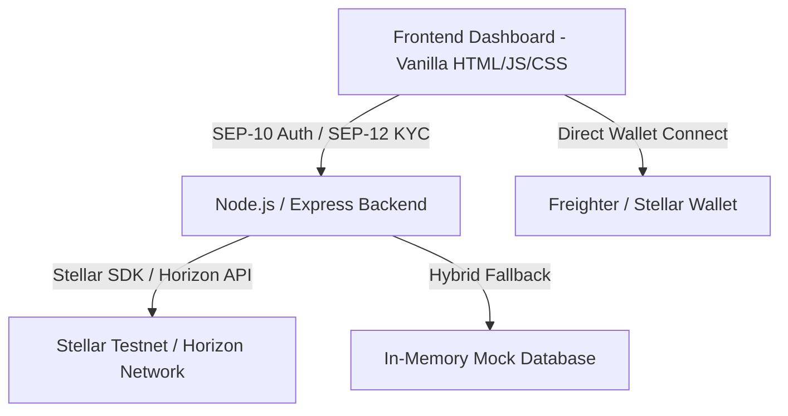

# 🚀 InvoiceFin: Decentralized B2B Invoice Financing

**InvoiceFin** is a premium, decentralized B2B invoice financing platform that bridges Web3 liquidity with real-world trade. It empowers Micro, Small, and Medium Enterprises (MSMEs) to cash out unpaid invoices instantly (within 24 hours), while providing global investors with high-yield, asset-backed investment opportunities.

---

## 🌟 Key Features

### 1. 🛡️ Native Stellar Compliance (SEP-10 & SEP-12)
* **SEP-10 (Decentralized Authentication)**: Secures all client-server communications with cryptographic proof-of-ownership via Stellar wallet signatures (e.g., Freighter).
* **SEP-12 (Institutional KYC)**: Multi-document government ID compliance verification (Aadhaar, PAN, Passport, and National IDs) completed in under 60 seconds.

### 2. 📊 Dynamic AI-Driven Risk Scoring
* Real-time wallet analysis utilizing the Stellar Horizon API.
* Dynamic grading logic:
  * **Grade A**: Excellent on-chain track record (>= 50 transactions, >= 5,000 XLM).
  * **Grade B**: Reliable profile (>= 15 transactions, >= 1,000 XLM).
  * **Grade C**: Active starter (>= 1 transaction, >= 100 XLM).
  * **Grade D (High Risk)**: Brand new or unfunded wallets (0 transactions or < 100 XLM) to prevent malicious actors and fraud.

### 3. 🤖 Autonomous Yield-Matching Agents
* Allows investors to automate their deployment. Set custom risk parameters (e.g., *"Only purchase Grade A invoices with yield > 5%"*) and let our autonomous agents purchase fractionalized invoices instantly upon listing.

### 4. 💎 Premium Dark-Glassmorphism UI
* An immersive, premium dashboard experience featuring live wallet connections, dynamic regulatory tracking, interactive KYC compliance pipelines, and clear statistics panels.

---

## 🛠️ Architecture & Tech Stack



* **Frontend**: HTML5, Vanilla JavaScript (ES6+), Premium CSS styling.
* **Backend**: Node.js, Express, `jsonwebtoken` (JWT), `stellar-sdk`.
* **Blockchain Integrations**: Native Stellar Horizon, Stellar wallet integration.

---

## 🚀 Getting Started

### Prerequisites
Make sure you have [Node.js](https://nodejs.org/) (v16+) installed.

### Installation & Setup

1. **Clone the Repository**:
   ```bash
   git clone <your-repository-url>
   cd copilot-main
   ```

2. **Install Root & Sub-directory Dependencies**:
   ```bash
   npm install
   cd backend && npm install
   cd ../frontend && npm install
   cd ..
   ```

3. **Configure Environment Variables**:
   Create a `.env` file inside the `backend` directory:
   ```env
   PORT=3001
   JWT_SECRET=your_jwt_super_secret_key
   STELLAR_SIGNING_KEY=your_stellar_private_key_here
   ```

4. **Launch the Development Servers**:
   Run the following command in the project root directory:
   ```bash
   npm run dev
   ```
   * **Frontend Dashboard**: Served at [http://localhost:3000](http://localhost:3000)
   * **Express API Server**: Running at [http://localhost:3001](http://localhost:3001)

---

## 📡 API Endpoints Summary

| Method | Endpoint | Description |
| :--- | :--- | :--- |
| **GET** | `/api/health` | Service health status |
| **GET** | `/api/stats` | Overall platform volume and financing metrics |
| **GET** | `/api/invoices` | List all available and funded invoices |
| **POST** | `/api/invoices` | Create and list a new unpaid invoice |
| **POST** | `/api/invest` | Submit an investment into a listed invoice |
| **GET** | `/api/wallet-grade/:address` | Fetch live Stellar Horizon credit grade |
